<div align="center">

<picture>
  <source media="(prefers-color-scheme: dark)" srcset="docs/assets/banner-dark.svg">
  <source media="(prefers-color-scheme: light)" srcset="docs/assets/banner-light.svg">
  
</picture>

<br>


<a href="LICENSE"></a>


**One command center for everything AI does on your laptop or server:**<br>
what it costs, how often it is wrong, what your agents are doing right now and how your knowledge grows,<br>
plus an agentic workspace (beta): one API for your models, 17 agents that work together, workflows, RAG, MCP and A2A.

[Features](#features) · [Screenshots](#screenshots) · [Quick start](#quick-start) · [Agentic workspace](#agentic-workspace) · [Topology](#provider-topology) · [Monitors](#monitors-and-alerts) · [Local models](#local-model-servers) · [OpenTelemetry](#opentelemetry-export) · [How it works](#how-it-works) · [Metrics](#what-the-quality-metrics-mean) · [Privacy](#privacy) · [Contributing](#contributing)

</div>

<br>

<p align="center">
  
</p>
<p align="center"><sub>Demo data. Every page is a holographic deck with its own 3D scene; drag to rotate, hover for details, click a card for a drill-down.</sub></p>

## Why ZAAFPulse

AI coding agents now run for hours, read thousands of files and call hundreds of tools. Their logs already sit on your disk, but nobody reads 2 GB of JSONL. ZAAFPulse reads it for you and answers these questions at a glance:

| | Question | What you get |
|---|---|---|
| **$** | *What is AI costing me?* | API-equivalent spend per day, model, project and session at **provider list prices** (checked against Anthropic's and OpenAI's own price lists, kept current from OpenRouter's public list), with each API response counted once even when a session was resumed or forked, a month-end projection, and where the money goes: input, output, cache reads, cache writes or web searches. |
| **✓** | *Can I trust what it did?* | Tool-call accuracy that counts only failures the model caused, non-existent targets (paths, edit text, arguments, URLs, packages and commands that did not exist) and how often you had to correct it. |
| **⚠** | *Did anything unsafe happen?* | Prompt-injection attempts in web and MCP content, secrets that surfaced in tool output, and risky commands such as `rm -rf` or force pushes. |
| **◈** | *What are my agents doing right now?* | A live 3D office: every session and subagent walks to the room for the tool it is using, waits at the help desk when it needs you, and shows up in a request log, a stream inspector and a timeline. A topology on the Overview shows which tool reaches which router, runtime and provider through ZAAFPulse, and the path of each recent request. |
| **!** | *Will I hear about it when something goes wrong?* | Monitors on daily cost, the month's projection, cost bursts, tool loops, stuck agents, accuracy, eval pass rates and unsafe content, with alerts in the dashboard, as a desktop notification or a webhook. You can pause the agent behind an alert, or let a cost or loop rule pause it. |
| **◉** | *Is my second brain growing?* | One animated map of Obsidian, Logseq, Notion, Tana, Roam, mem.ai, Reflect, Heybrain, a PARA workspace, your RAG knowledge and vector databases: hubs, orphans, PARA lanes, a semantic map by meaning, and a replay of how it grew. |
| **⌁** | *Can my apps and coding tools use any model through one API?* | An Agent Gateway (beta) on 127.0.0.1: API keys with scopes, budgets and rate limits; OpenAI, Anthropic, Responses and Gemini endpoints over 52 provider presets with fallback routes, quota and a token saver; Claude Code, Codex, Gemini CLI and more connected in one click. |
| **⚙** | *Can my agents work together, safely?* | In beta: 17 domain agents, an orchestrator, seven collaboration patterns (vote, debate, review, group chat, handoff …) with budgets and traces, 24 ready-made workflows with approval gates, RAG, A2A, and Agent Skills that teach any AI to use all of it. |
| **⇄** | *Can my agents reach the rest of my stack?* | An MCP server for Claude Code, Cursor, VS Code, Codex, Gemini CLI and five more clients, with connectors to Dynatrace, Arize Phoenix and AX, n8n, OmniRoute, 9router and any HTTP or MCP service, plus a page that shows every connection's health. Gateway traces can go to Dynatrace, Arize, Langfuse or any other backend that takes OTLP over HTTP. |

## Features

<table>
<tr>
<td width="33%" valign="top">

**Usage & cost**<br>
<sub>Tokens, sessions, prompts, models and projects across Claude Code and Codex, each API response counted once across resumed and forked sessions. Cost at list price with cache-aware rates, long-prompt tiers, fast mode and web searches, a monthly budget meter, a projection, and a 3D "usage city" of every day.</sub>

</td>
<td width="33%" valign="top">

**Quality & safety**<br>
<sub>Accuracy, non-existent targets, poisoning, corrections, relevance, faithfulness, secrets, risky commands, API errors, loops and compactions, plus subpages for <b>Utilization</b>, <b>Cache</b>, <b>Compression</b> and <b>Provider stats</b>.</sub>

</td>
<td width="33%" valign="top">

**AI Office, live**<br>
<sub>A 3D office driven by real transcript state: who is editing, reading, running commands, browsing or delegating, who is waiting for you and who needs approval. Subagents appear next to their parent.</sub>

</td>
</tr>
<tr>
<td valign="top">

**Provider topology**<br>
<sub>ZAAFPulse as the hub of a graph on the Overview: AI tools above it, routers and local runtimes below, providers and loaded models at the bottom. Each line is coloured active, recent, error or idle. Click a recent request to light up its path, or a node to highlight its neighbours; zoom and pan.</sub>

</td>
<td valign="top">

**Trace & Session Explorer**<br>
<sub>One session of Claude Code, Codex, the Agent Gateway, Kiro, Gemini CLI or Antigravity as a tree of spans with a timeline and a map of the turn. Text is read from the original log only when you open a span, with secrets masked, and is never copied.</sub>

</td>
<td valign="top">

**Monitors & alerts**<br>
<sub>Eight rules on cost, quality and agent behaviour, with alerts in the top bar, a desktop notification or a webhook. Pause, resume or stop the agent behind a session, or let a cost or loop rule pause it (off by default). Snooze a rule for an hour or a day.</sub>

</td>
</tr>
<tr>
<td valign="top">

**Local evals & feedback**<br>
<sub>Six code checks that cost nothing, and five judge evaluators for finished turns, answered first by Ollama or LM Studio on this machine. Rate turns Good or Bad and see how often the judge agrees with you.</sub>

</td>
<td valign="top">

**Datasets & replay**<br>
<sub>Save turns from the Trace explorer, replay them on up to three models, score and compare the runs, and fail a CI build with <code>zaafpulse eval --ci</code> when a pass rate drops.</sub>

</td>
<td valign="top">

**Local model servers**<br>
<sub>Start and Stop on the AI Office cards for Ollama, LM Studio, the llama.cpp server, Jan, LocalAI and servers you add in Settings. Start loads Ollama's and LM Studio's last models again and keeps them loaded until Stop. Your own commands run only after you approve them.</sub>

</td>
</tr>
<tr>
<td valign="top">

**Logs, proxy & timeline**<br>
<sub>Real-time request log with TTFT and duration, error traces and a stream inspector; OmniRoute upstream and MCP hub traffic; a timeline of every agent and subagent with parallelism.</sub>

</td>
<td valign="top">

**Live monitor**<br>
<sub>Which AI apps are running right now (Claude Code, Claude Desktop, Codex, ChatGPT, Antigravity, Cursor, Ollama, LM Studio) as a 3D fleet, with CPU, memory, machine share and load.</sub>

</td>
<td valign="top">

**Second brain graph**<br>
<sub>Obsidian by default, plus <b>Logseq</b>, <b>Notion</b>, <b>Tana</b>, <b>Roam Research</b>, <b>mem.ai</b>, <b>Reflect</b>, <b>Heybrain</b>, a <b>PARA</b> workspace, the <b>RAG</b> knowledge bases and vector databases (<b>Pinecone</b>, <b>Weaviate</b>, <b>Qdrant</b>, <b>pgvector</b>, <b>Chroma</b>). One animated map with six layouts: network, PARA lanes, semantic map (records placed by embedding meaning, nearest-neighbour links, clusters), hierarchy, timeline and all sources together (same-titled notes joined across tools). Pulses along links, search, legend filters, backlinks, open in the source app, a growth replay and a 3D chart of notes per week.</sub>

</td>
</tr>
<tr>
<td valign="top">

**MCP hub & integrations**<br>
<sub>An MCP server for Claude Code, Kiro, Antigravity, Cursor, VS Code, Claude Desktop, Codex, Gemini CLI, Windsurf/Devin and Zed, with connectors to Dynatrace, Arize, n8n, OmniRoute, 9router and any HTTP or MCP service, shown as a 3D hub. Add, configure and test integrations right on the page.</sub>

</td>
<td valign="top">

**Drill-downs everywhere**<br>
<sub>KPI cards are compact glass tiles with sparklines drawn from real series; each one opens a panel with charts, breakdowns and tables. Keyboard support, reduced motion respected.</sub>

</td>
<td valign="top">

**Always on**<br>
<sub>Optional macOS LaunchAgents keep the server running and bring the dashboard to the front at login and whenever you open the lid, reusing the same tab.</sub>

</td>
</tr>
<tr>
<td valign="top">

**Model prices**<br>
<sub>Built-in prices checked against Anthropic's and OpenAI's official lists, an offline snapshot of OpenRouter's public list shipped with the app, and, when the machine is online, a live sync of that list every 12 h. A card per model with prices, context, tags and your spend; pin your own price anytime.</sub>

</td>
<td valign="top">

**Model catalog**<br>
<sub>Anthropic, OpenAI, Google, DeepSeek, Alibaba, xAI, Meta, Tencent and Z.ai, filterable by vendor and searchable. The full catalog comes from the live list and needs network (the last copy is cached); offline, the shipped snapshot still prices 215 models.</sub>

</td>
<td valign="top">

**OpenRouter models & rankings**<br>
<sub>When online: the models on OpenRouter with live prices and per-provider uptime, the most-used models and apps this week, benchmark leaders, and the inference-provider directory, all as 3D decks.</sub>

</td>
</tr>
<tr>
<td valign="top">

**Endpoint & code tools**<br>
<sub>API keys, the MCP server (register it in any of ten clients, or connect over HTTP), snippets, and one-click setup of Claude Code, Codex, Gemini CLI, OpenCode and Aider on any provider, with backup and revert.</sub>

</td>
<td valign="top">

**Agent Gateway & model router** (beta)<br>
<sub>OpenAI ⇄ Anthropic ⇄ Responses ⇄ Gemini translation, native Responses and Anthropic passthrough, 52 provider presets, fallback routes with cooldown after a 429, quota and balances, self-refreshing OAuth2 and service-account tokens, a token saver for long tool results, and a playground.</sub>

</td>
<td valign="top">

**Agent-to-Agent & workflows** (beta)<br>
<sub>17 domain agents, an orchestrator with a parallel plan, vote, debate, review loop, group chat and handoff with budgets, verdicts and live traces, 24 ready-made workflows with approval gates, and the A2A protocol.</sub>

</td>
</tr>
<tr>
<td valign="top">

**Agent skills**<br>
<sub>Nine SKILL.md files that teach any AI agent to use ZAAFPulse, served from the running version and installable into Claude Code or `~/.agents/skills`, plus a view of the subagents, skills and tools your AI tools actually use.</sub>

</td>
<td valign="top">

**RAG service**<br>
<sub>Knowledge bases with ingestion from text, files or a URL, a local vector store, hybrid embedding + BM25 search, an API, and agents that cite the documents they used.</sub>

</td>
<td valign="top">

**Answer quality**<br>
<sub>Relevance and faithfulness per turn, computed locally from transcripts: off-topic replies and references (files, identifiers, URLs, numbers) that appeared nowhere in the session.</sub>

</td>
</tr>
<tr>
<td valign="top">

**OpenTelemetry export**<br>
<sub>Off by default. When you turn it on, gateway, agent and tool spans go over OTLP/HTTP with GenAI semantic-convention attributes to Dynatrace, Arize Phoenix or AX, Langfuse or a Collector. No prompt text unless you ask for it.</sub>

</td>
<td valign="top">

**Measured, with the method**<br>
<sub>The detectors are scored on a labelled synthetic corpus (precision and recall per detector) and the indexer on a seeded benchmark. Both scripts are in the repo, so you can rerun them.</sub>

</td>
<td valign="top">

**Checked releases**<br>
<sub>Checksums on every release file after 1.0.0 and, from 1.0.3, build-provenance attestations you can check with <code>gh attestation verify</code>. Single-file binaries after 1.0.3 check their unpacked files on every start and restore any that changed.</sub>

</td>
</tr>
</table>

| At a glance | |
|---|---|
| Runtime dependencies | **0** (Node standard library only; postject is a build-only dev dependency) |
| First index of 2 GB of logs | about **30 s** with worker threads, about **70 s** on one thread or a busy machine; a rescan with no changes takes **1–3 ms**. Worked out from 66 MB/s (worker threads) and 24–62 MB/s (one thread) measured on synthetic logs on an Apple M4 ([method and numbers](docs/performance.md)) |
| Network exposure | **127.0.0.1 only**, host-header checked, sign-in on by default; outbound only to the places listed under [Privacy](#privacy) |
| 3D scenes | plain `<canvas>` 2D with an isometric projection: no WebGL, no libraries |
| Themes | Light and dark chrome, follows your system; the decks stay dark |

## Screenshots

<details open>
<summary><b>Overview & live monitor</b>: usage, cost, the provider topology and what is running right now</summary>
<br>
<p align="center">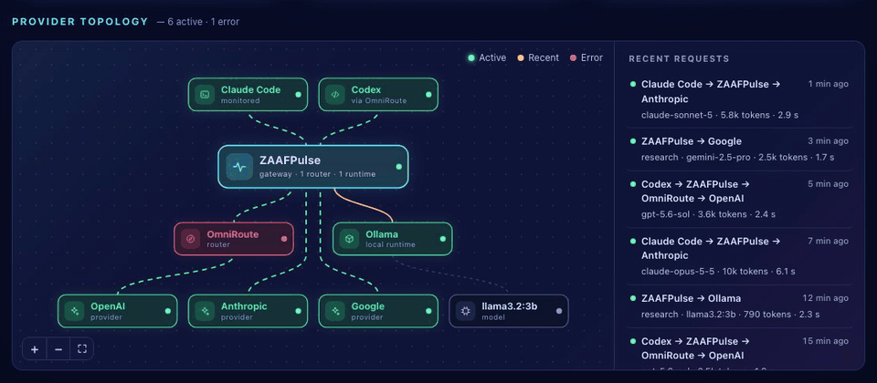</p>
<p align="center"><sub>The provider topology on the Overview. Each recent request lights up its path through ZAAFPulse; a node shows its status and note.</sub></p>

<p align="center"><sub>Overview: a 3D usage city of every day, with spend, tokens, sessions and the month's projection.</sub></p>
<table>
<tr>
<td width="50%">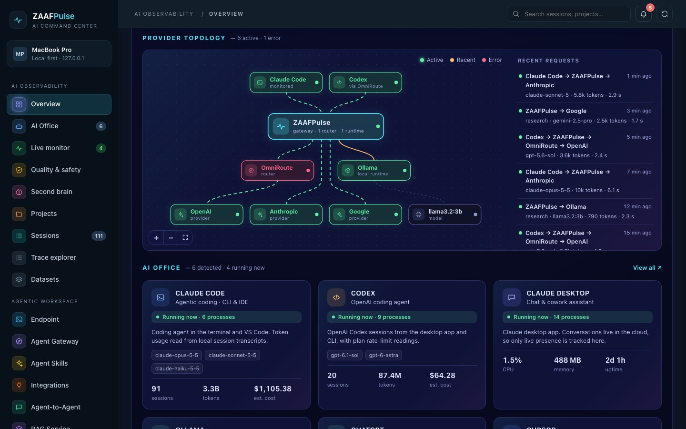<br><sub>Provider topology: tools, the hub, routers and runtimes, providers and models, with recent requests.</sub></td>
<td width="50%"><br><sub>Live monitor: running AI apps as a 3D fleet, with CPU, memory and a paused agent.</sub></td>
</tr>
<tr>
<td width="50%"><br><sub>Sessions: every session by day and start hour.</sub></td>
<td width="50%"><br><sub>Drill-down: estimated spend, the projection against the budget, and where the money goes.</sub></td>
</tr>
</table>
</details>

<details open>
<summary><b>AI Office</b>: your agents at work in a 3D office, and the local model servers</summary>
<br>
<p align="center"></p>
<p align="center"><sub>Agents walk to the room for the tool they are using.</sub></p>
<table>
<tr>
<td width="50%"><br><sub>AI Office: live activity, state counts and a paused agent.</sub></td>
<td width="50%">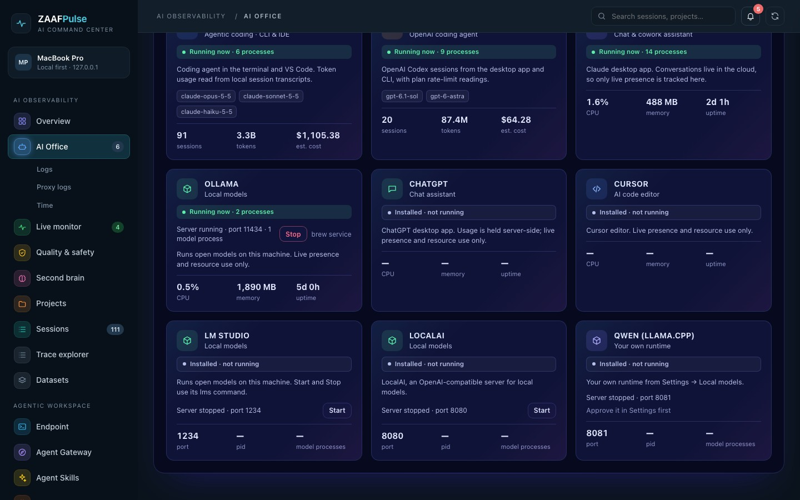<br><sub>Local model servers: Start and Stop on the Installed AI tools cards.</sub></td>
</tr>
<tr>
<td width="50%"><br><sub>Logs: requests with TTFT and duration, and the stream inspector.</sub></td>
<td width="50%"><br><sub>Time: who worked on what, when, and in parallel.</sub></td>
</tr>
<tr>
<td width="50%"><br><sub>Proxy logs: OmniRoute upstream attempts and MCP hub calls.</sub></td>
<td width="50%"></td>
</tr>
</table>
</details>

<details open>
<summary><b>Quality & safety</b>: accuracy, evals, utilization, cache, compression, providers, models and rankings</summary>
<br>

<p align="center"><sub>Quality & safety: signals detected in your logs, each card opening the items that matched.</sub></p>
<table>
<tr>
<td width="50%">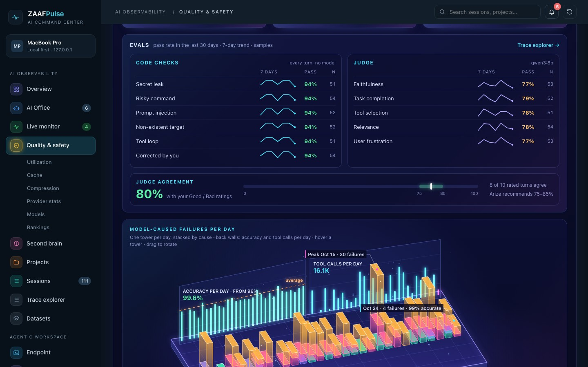<br><sub>Evals: code checks and judge evaluators, and how often the judge agrees with you.</sub></td>
<td width="50%"><br><sub>Drill-down: every prompt-injection match, external content first.</sub></td>
</tr>
<tr>
<td width="50%"><br><sub>Utilization: load by weekday and hour, peaks and a forecast.</sub></td>
<td width="50%"><br><sub>Cache: hit rate, savings and the write premium.</sub></td>
</tr>
<tr>
<td width="50%"><br><sub>Compression: compactions, context pressure and tokens avoided.</sub></td>
<td width="50%"><br><sub>Provider stats: requests, cost and latency per provider and model.</sub></td>
</tr>
<tr>
<td width="50%"><br><sub>Models: OpenRouter's catalog with live prices.</sub></td>
<td width="50%"><br><sub>Rankings: the most-used models this week and benchmark leaders.</sub></td>
</tr>
</table>
</details>

<details open>
<summary><b>Trace explorer, datasets & replay</b>: one session span by span, saved turns, and replays on other models</summary>
<br>
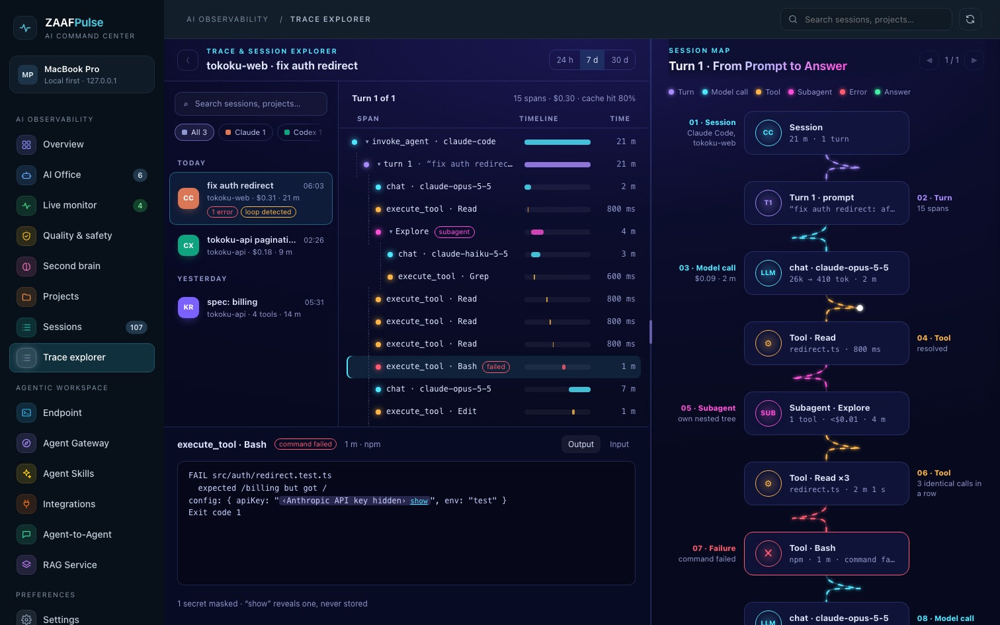
<p align="center"><sub>Trace explorer: one turn as spans, its text on request with secrets masked, and a map of the turn.</sub></p>
<table>
<tr>
<td width="33%">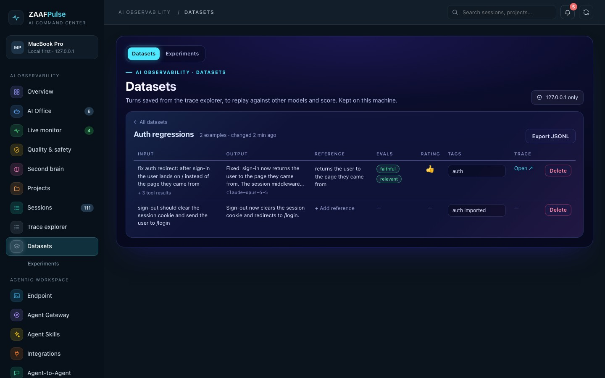<br><sub>A dataset: saved turns with their reference, evals and rating.</sub></td>
<td width="33%">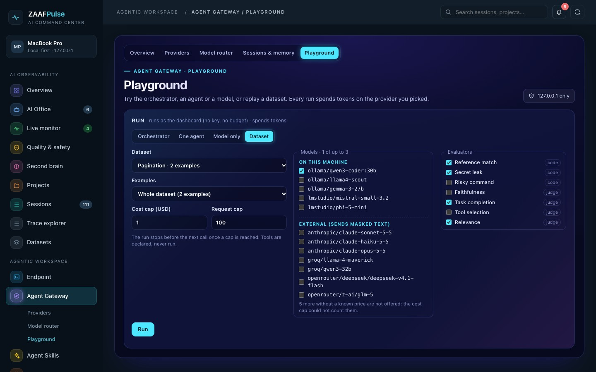<br><sub>Replay: a dataset on up to three models, local first, with caps.</sub></td>
<td width="33%">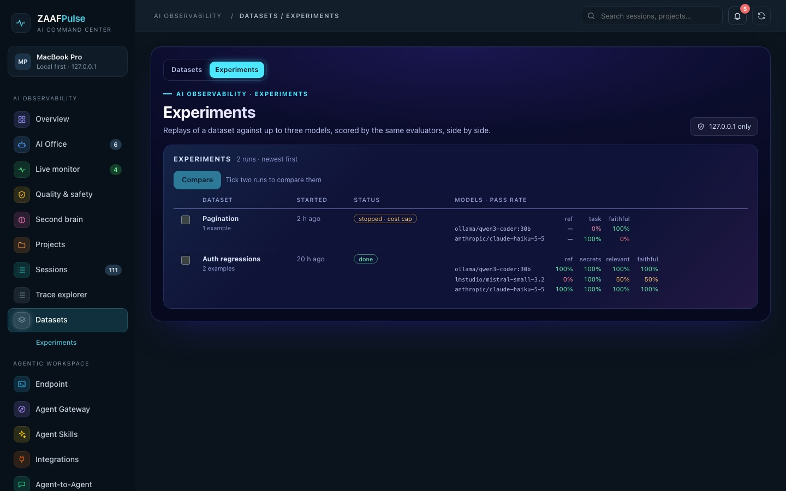<br><sub>Experiments: pass rates per model, side by side.</sub></td>
</tr>
</table>
</details>

<details open>
<summary><b>Monitors & local models</b>: rules, alerts, agent pause and your own model servers</summary>
<br>
<table>
<tr>
<td width="50%">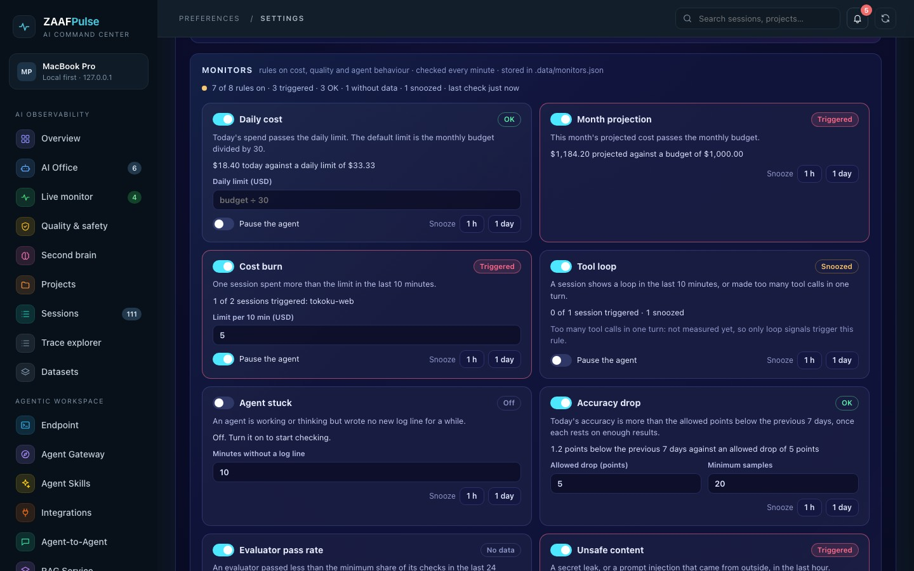<br><sub>Monitors: eight rules, each with its state, limits, snooze and auto-pause.</sub></td>
<td width="50%">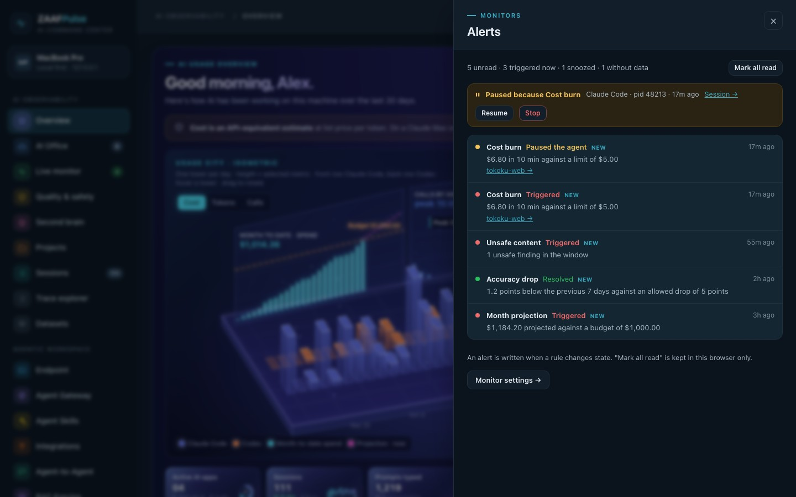<br><sub>Alerts: the bell's drawer, with Resume and Stop for a paused agent.</sub></td>
</tr>
<tr>
<td width="50%">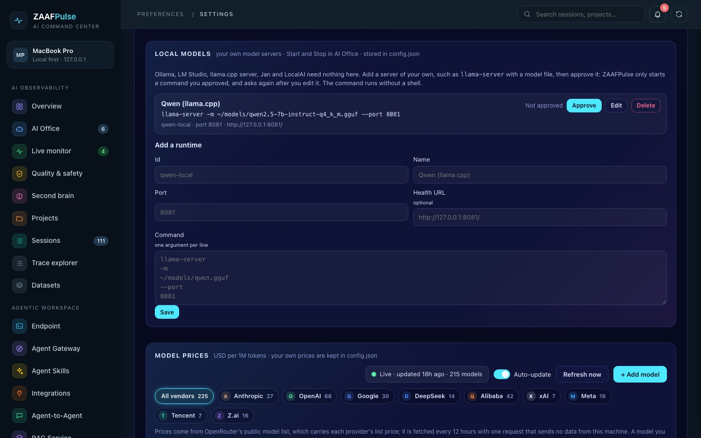<br><sub>Settings → Local models: add your own server and approve it.</sub></td>
<td width="50%"><br><sub>Settings → Model prices: live list prices and your spend per model.</sub></td>
</tr>
</table>
</details>

<details open>
<summary><b>Second brain</b>: your knowledge as a living map (Obsidian and 14 more sources)</summary>
<br>
<p align="center"></p>
<p align="center"><sub>A growth replay of every source on one map.</sub></p>

<p align="center"><sub>Second brain: how the vault grew, week by week.</sub></p>
<table>
<tr>
<td width="33%"><br><sub>All sources on one map.</sub></td>
<td width="33%"><br><sub>Semantic map of a vector store.</sub></td>
<td width="33%"><br><sub>PARA lanes.</sub></td>
</tr>
</table>
</details>

<details open>
<summary><b>Agentic workspace</b>: endpoint, gateway, agents working together, workflows, skills and RAG</summary>
<br>
<p align="center"></p>
<p align="center"><sub>A group-chat run: the live trace, budget and blackboard fill in.</sub></p>
<table>
<tr>
<td width="50%"><br><sub>Agent Gateway: keys, the orchestrator and 17 domain agents.</sub></td>
<td width="50%"><br><sub>Endpoint: every endpoint with its scope.</sub></td>
</tr>
<tr>
<td width="50%"><br><sub>API keys: scopes, budgets and rate limits.</sub></td>
<td width="50%"><br><sub>MCP server: registration per client, and HTTP.</sub></td>
</tr>
<tr>
<td width="50%">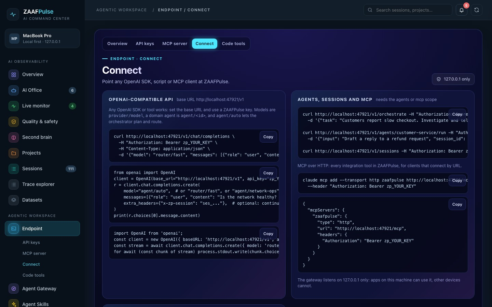<br><sub>Connect: snippets for any OpenAI SDK, script or MCP client.</sub></td>
<td width="50%"><br><sub>Code tools: set up a coding tool on any provider.</sub></td>
</tr>
<tr>
<td width="50%"><br><sub>Model router: quota, cooldown and the token saver.</sub></td>
<td width="50%"><br><sub>Providers: defaults and the presets.</sub></td>
</tr>
<tr>
<td width="50%"><br><sub>Playground: the plan and the answer.</sub></td>
<td width="50%"><br><sub>Workflows: 24 ready-made, with approval gates.</sub></td>
</tr>
<tr>
<td width="50%"><br><sub>Collaborate: pick a pattern and a budget.</sub></td>
<td width="50%"><br><sub>Runs: state, and approvals waiting.</sub></td>
</tr>
<tr>
<td width="50%"><br><sub>A run at an approval gate, with its trace.</sub></td>
<td width="50%"><br><sub>Agent skills: nine SKILL.md files.</sub></td>
</tr>
<tr>
<td width="50%"><br><sub>RAG service: knowledge bases.</sub></td>
<td width="50%"></td>
</tr>
</table>
<p align="center"></p>
<p align="center"><sub>The Agent Gateway in 3D, with pulses for recent calls.</sub></p>
</details>

<details>
<summary><b>Projects, agent skill usage, integrations</b></summary>
<br>
<table>
<tr>
<td width="50%"><br><sub>Projects: where AI time goes.</sub></td>
<td width="50%"><br><sub>What your AI reaches for: subagents, skills and tools.</sub></td>
</tr>
<tr>
<td width="50%"><br><sub>Integrations: the MCP hub and each connection's health.</sub></td>
<td width="50%"><br><sub>Integration editor: configure and test a connection.</sub></td>
</tr>
</table>
</details>

<sub>All screenshots and GIFs use the built-in demo dataset (`npm run demo`). No real projects, costs, notes or accounts are shown. Regenerate them with `npm run media` (needs Google Chrome and ffmpeg; `MEDIA_PORT` and `MEDIA_CDP_PORT` move its ports). The Models, Rankings and price shots need OpenRouter's public lists cached in `.cache/` by a normal run, since demo mode fetches nothing.</sub>

## Quick start

ZAAFPulse runs on **macOS, Linux (Ubuntu, Debian, RHEL, Rocky, AlmaLinux, Fedora, Amazon Linux, SUSE, Alpine) and Windows 10/11**, on a laptop or a server. Pick one of these:

| | One command |
|---|---|
| **macOS / Linux** | `curl -fsSL https://raw.githubusercontent.com/rifqifitriady/ZAAFPulse/main/install.sh \| sh` |
| **Windows 11** (PowerShell) | `irm https://raw.githubusercontent.com/rifqifitriady/ZAAFPulse/main/install.ps1 \| iex` |
| **Linux server** | `curl -fsSL https://raw.githubusercontent.com/rifqifitriady/ZAAFPulse/main/install.sh \| sudo sh -s -- --server` |
| **Docker** | `docker compose up -d` (see [compose.yaml](compose.yaml)); mainly a gateway and server deployment, see [Docker](#docker) |
| **Single file** | download `zaafpulse-<version>-<os>-<cpu>` from [Releases](https://github.com/rifqifitriady/ZAAFPulse/releases) and run it |

The installers use your Node.js 18+ or download the official Node.js LTS (checksum verified) into their own folder. They add the `zaafpulse` command and start it in the background (launchd, systemd or Task Scheduler). Then run **`zaafpulse open`**: it opens http://localhost:4777 in your browser, already signed in.

```bash
zaafpulse status      # is it running?
zaafpulse doctor      # OS, Node.js, data folder, secret store, log folders and file counts, service
zaafpulse eval --judge --session <id>   # judge one session with a local model (or a confirmed Claude Code), no dashboard needed
zaafpulse eval --dataset <slug> --model <provider/model> --ci   # replay a dataset and gate on pass rates (docs/datasets.md)
zaafpulse open        # open the dashboard, signed in
zaafpulse service restart | uninstall
zaafpulse help
```

**From source** (any OS with Node 18+, no npm packages):

```bash
git clone https://github.com/rifqifitriady/ZAAFPulse.git && cd ZAAFPulse
npm start          # reads your logs  → http://localhost:4777 (then `node bin/zaafpulse.js open` to sign in)
npm run demo       # synthetic data   → http://localhost:4778
npm test           # run the test suite (node:test, no dependencies)
npm run media      # regenerate README screenshots and GIFs from demo data
```

The first start indexes your logs: about 30 seconds for 2 GB with worker threads, about 70 seconds on one thread or a busy machine ([measured](docs/performance.md)). After that the server rescans every minute and only re-reads files that changed; a rescan with no changes takes a few milliseconds, and a large session that grew is parsed again as a whole (0.4–0.9 s for 24 MB in the benchmark). Server mode, TLS, Docker, single-file builds and every option are in **[docs/install.md](docs/install.md)**.

### Verifying a download

- Every release after 1.0.0 has `SHA256SUMS.txt`. The installers check the release's source package against it and stop when they cannot.
- From 1.0.3, every release file also has a build-provenance attestation: `gh attestation verify zaafpulse-<v>-linux-x64 --repo rifqifitriady/ZAAFPulse` shows the workflow and commit that built it.
- Single-file binaries after 1.0.3 carry the SHA-256 of every app file. On every start they check the unpacked copy in the cache folder, restore any file that was changed, removed or added, and stop when they cannot.
- Version tags are never moved; a fix ships as a new version. A tag ruleset blocks moving or deleting `v*` tags, and releases are immutable once published ([docs/release-hardening.md](docs/release-hardening.md)). Both have been on since 20 October 2026, so releases after 1.0.3 also pass `gh release verify`; v1.0.0 to v1.0.3 were published before and are not immutable.
- The binaries are **not yet notarized or code-signed**. macOS quarantines a browser download (run `xattr -d com.apple.quarantine zaafpulse-*` once, or download with `curl`), and Windows SmartScreen asks once (*More info → Run anyway*).

### Signing in

Sign-in is on by default, on every OS:

- **Local sign-in** (the default on 127.0.0.1): only your OS account can open the dashboard. Open it with `zaafpulse open`, or start with `zaafpulse start --open`. The browser is signed in with a one-time code that is kept off the command line, so other accounts on the machine never see it.
- **Password** in server mode or behind a reverse proxy (below).
- **None** only when you ask for it with `ZAAFPULSE_AUTH=none`, and in demo mode on a single-user machine (its data is synthetic). Without sign-in, any program or other account on the machine could use the dashboard as you.

Details, including the autostart opener and Windows: [docs/install.md](docs/install.md#who-can-open-the-dashboard).

### Server mode

By default ZAAFPulse listens on 127.0.0.1 only. `--server` (or `zaafpulse start --host 0.0.0.0`) makes it reachable from other machines:

- The dashboard asks for an admin password of at least 10 characters, set with `zaafpulse set-password` (scrypt hash) or `ZAAFPULSE_ADMIN_PASSWORD`. It refuses to start without one. Sessions are HttpOnly, SameSite=Strict cookies. Wrong guesses are throttled per address with a growing wait; a browser that signed in before keeps its own count, so someone guessing elsewhere does not lock the owner out.
- Apps reach the gateway (`/v1`, `/mcp`, `/a2a`) with ZAAFPulse API keys, as before.
- Serve HTTPS with `ZAAFPULSE_TLS_CERT` and `ZAAFPULSE_TLS_KEY`, or use a reverse proxy (`ZAAFPULSE_TRUST_PROXY=1`, `ZAAFPULSE_PUBLIC_URL=https://…`).

### Docker

The image runs in server mode (password sign-in) and keeps its data in the `/data` volume. [compose.yaml](compose.yaml) does **not** mount `~/.claude` or `~/.codex`, so out of the box the usage, cost, quality and office pages are empty, and the live monitor only sees the container's own processes. In Docker, ZAAFPulse is mainly the Agent Gateway, agentic workspace and MCP tools.

To see the host's Claude Code and Codex logs, mount them read-only where the parsers look: `~/.claude/projects` and `~/.codex/sessions` under the home of the container's `node` user. For example, under `volumes:` in compose.yaml:

```yaml
      - ${HOME}/.claude/projects:/home/node/.claude/projects:ro
      - ${HOME}/.codex/sessions:/home/node/.codex/sessions:ro
```

The container runs as `node`, so those files must be readable by that user's uid. Setup, the master key and proxies: [docs/install.md](docs/install.md#docker).

### Nothing shows up?

If the Overview shows 0 sessions, 0 tokens and $0 even though your AI apps are running, ZAAFPulse has not found any logs. Run **`zaafpulse doctor`**: it lists every folder it reads, whether it exists, how many `.jsonl` files it holds and how recent the newest is. The Overview also says where it looked when it finds nothing.

- Claude Code logs are read from each folder in `ZAAFPULSE_CLAUDE_DIRS` (comma-separated, each with a `projects/` folder inside) when it is set; otherwise from `$CLAUDE_CONFIG_DIR/projects` (one folder, as Claude Code reads it) when that is set; otherwise from `~/.config/claude/projects` (or `$XDG_CONFIG_HOME/claude/projects`) and then `~/.claude/projects`. Codex logs are read from `~/.codex/sessions`, or `$CODEX_HOME/sessions`.
- Using another folder? Set `CLAUDE_CONFIG_DIR` (or `ZAAFPULSE_CLAUDE_DIRS` for several) or `CODEX_HOME` **before starting ZAAFPulse**. The background service does not inherit your shell profile; `zaafpulse service install` copies these variables from the shell it runs in, so export them and run it again after any change. Details: see [docs/install.md](docs/install.md#the-background-service-does-not-see-your-shell-variables).
- Claude Desktop, ChatGPT and other chat apps keep no readable logs; they show as apps only.

### Run it on login (macOS, from source)

```bash
zaafpulse service install          # or: node bin/zaafpulse.js service install
./scripts/install-autostart.sh     # the older macOS setup: also brings the dashboard to the front in Chrome on wake
```

`scripts/install-autostart.sh` installs two LaunchAgents: `com.zaaf.aipulse.server` (starts at login, restarts on crash) and `com.zaaf.aipulse.opener` (brings the dashboard tab to the front in Chrome at login and whenever the Mac wakes). macOS asks once for permission to control Chrome. Logs go to `~/Library/Logs/AIPulse/`.

## MCP server and integrations

`node mcp.js` is an MCP server (stdio) named `zaafpulse` that AI clients start on demand. It offers the dashboard's own data and a connector for each platform you configure under `integrations` in `config.json`. Register it once:

```bash
zaafpulse register-mcp all                  # every supported client found on this machine (backs up each config first)
npm run mcp:register -- cursor --data ~/zp  # from source: one client, with the data folder its server should use
npm run mcp:register -- codex --dry-run     # show what would change, without writing
```

Supported clients: Claude Code, Kiro, Antigravity, Cursor, VS Code, Claude Desktop, Codex, Gemini CLI, Windsurf/Devin and Zed. `all` registers only the clients it finds here and lists the others as skipped. Only ZAAFPulse's own entry is touched, and an entry from an earlier release under the old name `ai-command-center` is migrated to `zaafpulse`. Paths per client and OS, and what registration changes: [docs/integrations.md](docs/integrations.md#registering-clients).

Or use **Endpoint → MCP server** in the dashboard: it shows where the server is registered, registers or removes it per client, and gives the HTTP connection for clients that connect by URL. The HTTP endpoint `/mcp` follows the 2025-06-18 Streamable HTTP transport (stateless, one JSON reply per POST): it checks the `MCP-Protocol-Version` header, accepts protocol versions up to 2025-11-25, refuses JSON-RPC batches from clients on 2025-06-18 or later (older clients may still send up to 20 messages, each counted against the key's rate limit), and answers a missing or wrong key with 401 and `WWW-Authenticate`.

| Type | Platforms | Tools |
|---|---|---|
| `acc` (always on) | this dashboard | `usage_summary`, `quality`, `live_apps`, `trace_sessions` (session metadata only, no text; titles only from stdio and never over the gateway `/mcp`), `evals` (pass rates and the latest failures as ids and labels, read-only, no explanations), `integrations_status` |
| `dynatrace` | Dynatrace SaaS and Managed | problems, entities, metrics, logs, security problems, DQL (SaaS) |
| `arize` | Arize Phoenix and Arize AX | projects, spans, traces, datasets, experiments, monitors (AX) |
| `n8n` | n8n | workflows, executions; run allowlisted webhooks and (de)activate workflows when writes are on |
| `router` | OmniRoute, 9router | health, models, providers, combos, usage, telemetry |
| `openrouter` | OpenRouter | model catalog and prices, which providers serve a model and their uptime, provider directory, rankings of models and apps, benchmarks; credits with a key |
| `http` | AION and any REST API | one tool per endpoint you declare |
| `mcp` | any Streamable HTTP MCP server | the upstream tools, filtered, under a `<id>__` prefix |

Tools are prefixed with the integration id (`dynatrace-saas_list_problems`). Everything is read-only unless an integration sets `"allowWrite": true`. Secrets stay in the OS secret store or environment variables, never in `config.json`, and a stored secret is only sent to the address it was saved for. The **Integrations** page shows each connection's health, which clients have the server registered, and recent tool calls. It also lets you **add, configure, test and delete** integrations: the form is built for each type, **Test connection** checks a draft before anything is saved, and a pasted secret goes straight to the OS secret store (on macOS over stdin to the Keychain, never into `config.json` or a process list). Setup per platform: [docs/integrations.md](docs/integrations.md).

## Agentic workspace

ZAAFPulse can sit in front of your models and agents. Everything listens on **127.0.0.1 only** unless you choose server mode.

> **Beta.** The Agent Gateway, the domain agents, the workflows and the collaboration engine are new. Their tests run against fake upstream servers, not live providers and clients, so expect rough edges: keep budgets on your keys, and please report what breaks.

The sidebar has two groups:

- **AI Observability:** Overview (with the provider topology), AI Office (with the local model servers), Live monitor, Quality & safety (with evals), Second brain, Projects, Sessions, Trace explorer, and Datasets with Experiments.
- **Agentic Workspace:**
  - **Endpoint:** API keys, the MCP server, connection snippets, code tools, and a table of every endpoint and its scope.
  - **Agent Gateway** (beta): a 3D overview, providers, model router, sessions and memory, and a playground.
  - **Agent Skills:** ZAAFPulse's own skills, and what your AI tools use.
  - **Integrations.**
  - **Agent-to-Agent** (beta): workflows, Collaborate, runs, specialist agents, patterns and A2A.
  - **RAG Service.**

| Layer | What it does |
|---|---|
| **Agent Gateway** | AuthN with ZAAFPulse API keys (`zp_…`, shown once, stored as SHA-256 hashes); AuthZ by scope (`llm`, `agents`, `rag`, `mcp`) and allowed model and agent globs, with a private-models-only option; per-key rate limit (requests per minute), monthly budget in USD and expiry; session management (24 h sessions per key). |
| **Orchestrator / Planner** | Task planning (the planner model writes a dependency graph of up to 6 steps; independent steps run in parallel), routing (each step goes to the best domain agent, with keyword routing as a fallback), and memory (session history plus long-term notes that agents save and recall). |
| **LLM Gateway / Model Router** | 52 provider presets: private LLMs on your own hardware (Ollama, LM Studio, **vLLM**, **TGI**, llama.cpp, Jan, LocalAI, LiteLLM) are always allowed; labs, inference clouds, routers, Asian providers and enterprise clouds (Azure OpenAI, Vertex AI, Bedrock) serve traffic only once **approved**; models come from each provider's own `/models`. Routes are virtual models (`router/fast`) that try their targets in order (fallback or round-robin); a 429 cools a target down (its reset time, or back-off to 5 minutes) and the route moves on. Rate-limit headers become a per-provider **quota** reading, with balances from OpenRouter, DeepSeek, Moonshot and SiliconFlow. Short-lived credentials **refresh themselves** (OAuth2 client credentials or refresh token, e.g. Entra ID; Google service accounts for Vertex), with one replay after a 401. |
| **Code tools** | Claude Code (Anthropic `/v1/messages`), Codex (OpenAI `/v1/responses`), Gemini CLI (`/v1beta/models/*`) and every OpenAI-compatible tool (OpenCode, Cline/Roo/Kilo, Copilot, Continue, Aider, Zed, Qwen Code, OpenClaw, Factory Droid) on **any** provider: requests are **translated** OpenAI ⇄ Anthropic ⇄ Responses ⇄ Gemini (tools, images, streaming, usage), or passed straight through: `/v1/messages` to a native Anthropic provider (with the client's `anthropic-version` and `anthropic-beta` headers), and `/v1/responses` unchanged to OpenAI, Azure OpenAI or any provider set to `responses: true`. OpenAI and Azure OpenAI get `max_completion_tokens`, which their reasoning models require; other providers keep `max_tokens` unless they serve an OpenAI reasoning model. A model map sends tool model names (`claude-*`, `gpt-*-codex`) to your models. One click writes a tool's config with its own key (backup + revert). The **token saver** shortens long tool results (diffs, logs, builds, grep, listings, JSON) before they go upstream and logs the tokens saved. Subscription logins are not used: API keys and official OAuth only. |
| **RAG Service** | Knowledge bases with document ingestion (text, Markdown, HTML, CSV, JSON, files or a URL) and a local vector database: chunks with embeddings from any provider's embedding model, searched by hybrid cosine + BM25 (keyword-only without an embedding model). Agents search attached knowledge bases with `zp_knowledge_search`. |
| **Agent-to-Agent** | A multi-agent collaboration engine with seven patterns (below), the **A2A protocol** (agent card + JSON-RPC/SSE, v1.0 with v0.3 accepted) for other agents to call in, and remote A2A agents that join a team. Agents consult each other with `zp_ask_agent` and hand conversations on with `zp_handoff`. **24 ready-to-use workflows** (incident triage to mitigation, postmortem, helpdesk, ticket triage, refunds, phishing triage, cited research, RFP and security questionnaires, contract redlines, code review, lead outreach, meeting actions, change risk, vulnerability plans, access requests, onboarding, month-end commentary, procurement, feedback to PRD, release notes, project status, PDP/OJK compliance, knowledge-base gaps, agent quality review) with risk tiers and **approval gates** that pause a run until someone approves. |
| **Domain agents** | 17 editable specialists: Customer Service, Sales & Marketing, Network Operations, HR & Finance, IT Helpdesk, SRE & Observability, Security, Data Analyst, DevOps, Code Reviewer, Research, Legal & Compliance, Product Manager, Project Manager, Procurement, Content Writer and AI Ops. Each has a prompt, a model and the integration tools it may call (function calling over the MCP connectors). |

**Providers**: any OpenAI-compatible API or the native Anthropic Messages API, with 52 presets in six groups (private, labs, inference clouds, routers, Asia, enterprise). Models come from each provider's own `/models`. Provider keys go to the OS secret store; short-lived tokens stay in memory.

```bash
# Models are provider/model; agent/<id> is a domain agent; agent/auto lets the orchestrator plan and route.
curl http://127.0.0.1:4777/v1/chat/completions -H "Authorization: Bearer zp_…" -H "Content-Type: application/json" \
  -d '{"model": "agent/auto", "messages": [{"role": "user", "content": "Checkout is slow. Check the network and draft a customer update."}]}'
```

| Endpoint | Scope | |
|---|---|---|
| `GET /v1/models` · `GET /v1/models/<id>` | any | provider models and agents this key may use; one model by id, for SDK `models.retrieve()` |
| `POST /v1/chat/completions` | `llm` / `agents` | OpenAI format, streaming; `x-zp-session` header continues a session. Agent and collaboration streams send headers and a keep-alive at once, then every 10 s. `agent/auto` with no default model set answers 400 with the reason |
| `POST /v1/embeddings` | `llm` | passthrough |
| `GET /v1/agents` · `POST /v1/agents/<id>/run` · `POST /v1/orchestrate` | `agents` | run one agent or the orchestrator, with the plan, tool calls and usage |
| `GET /v1/sessions` · `GET`/`DELETE /v1/sessions/<id>` | `agents` | the key's own sessions |
| `GET /v1/knowledge` · `POST /v1/knowledge/<id>/search` · `POST /v1/knowledge/<id>/documents` | `rag` | search a knowledge base, add documents |
| `GET /v1/workflows` · `POST /v1/workflows/<id>/run` | `agents` | run a multi-agent workflow (it pauses at approval gates) |
| `POST /v1/collaborate` | `agents` | a collaboration run: `pattern` (auto, parallel, vote, debate, review, group, handoff, agent, workflow), `effort`, `budget`, pattern options; `async: true` returns at once |
| `GET /v1/runs` · `GET /v1/runs/<id>` · `POST /v1/runs/<id>/cancel` · `POST /v1/runs/<id>/resume` | `agents` | run state, verdict, trace and blackboard; approve or reject a paused step (`{"approve": true, "note": "…"}`) |
| `GET /.well-known/agent-card.json` · `POST /a2a` | card public · `agents` | Agent2Agent: `SendMessage`, `SendStreamingMessage` (SSE), `GetTask`, `ListTasks`, `CancelTask`, `SubscribeToTask`; skill in `message.metadata.skill` |
| `POST /v1/messages` · `/v1/messages/count_tokens` | `llm` | Anthropic Messages (Claude Code); `x-api-key` works; `anthropic-beta` is forwarded to a native Anthropic provider |
| `POST /v1/responses` | `llm` | OpenAI Responses (Codex), streaming events included; passed through natively to OpenAI and Azure OpenAI (or `responses: true`), translated for every other provider |
| `POST /v1beta/models/<model>:generateContent` · `:streamGenerateContent` · `:countTokens` | `llm` | Gemini (Gemini CLI); `x-goog-api-key` works |
| `POST /mcp` | `mcp` | MCP over HTTP (2025-06-18 transport, versions up to 2025-11-25) with every integration tool (`claude mcp add --transport http zaafpulse http://127.0.0.1:4777/mcp --header "Authorization: Bearer zp_…"`) |
| `GET /v1/brain/sources` · `/v1/brain/search?q=` · `/v1/brain/graph?source=` | `rag` | the second brain, read only: titles, links, PARA buckets and structure, never note text |
| `GET /skills` · `/skills/<name>/SKILL.md` | none | agent skills (documentation only) |

### Agent skills

`skills/` holds nine Agent Skills (`SKILL.md` with name and description frontmatter). They teach any AI agent to use ZAAFPulse:

- `zaafpulse`: the entry point, covering setup, scopes, models and errors
- `zaafpulse-chat`: chat in all four wire formats, routes, the token saver and embeddings
- `zaafpulse-agents`: the domain agents and the orchestrator
- `zaafpulse-collaborate`: the collaboration patterns and runs
- `zaafpulse-workflows`: the workflows and their approval gates
- `zaafpulse-rag`: the knowledge bases
- `zaafpulse-brain`: the second brain, read only through `/v1/brain`
- `zaafpulse-mcp`: the integration tools
- `zaafpulse-a2a`: ZAAFPulse as an A2A agent

The gateway serves them at `/skills/<name>/SKILL.md`, so an agent always reads the version that is running. That avoids a public branch that can change. To give them to an agent:

- **Claude Code and other agents:** Agent Skills → pick a location (Claude Code, other agents, or both) → **Install or update** writes each skill folder to `~/.claude/skills/zaafpulse*` (or `$CLAUDE_CONFIG_DIR/skills` when that is set) and/or `~/.agents/skills`, the folder other Agent Skills clients share. Folders are marked, so a skill of yours with the same name is never overwritten, and **Remove** deletes only the marked folders.
- **Any other AI:** paste `Read this skill and use it: http://127.0.0.1:4777/skills/zaafpulse/SKILL.md`.

A test checks that every endpoint the skills document is one the gateway actually serves.

### Multi-agent collaboration

Built from the research in `reports/Multi agent collaboration design.md` (Anthropic's multi-agent research system, OpenAI Agents SDK, LangGraph, AutoGen/Magentic-One, CrewAI, MetaGPT, the A2A spec, debate and voting studies, and the MAST failure taxonomy). Default to one agent; collaborate when the task needs it.

| Pattern | When | How it stops |
|---|---|---|
| `auto` orchestrator | parts that need different specialists | the planner writes a dependency graph; independent steps run in parallel; leaf outputs are forwarded verbatim; `verify` adds a critic pass |
| `parallel` | several views of one question | specialists answer at once, one synthesis |
| `vote` | buy accuracy (the default way) | majority with a quorum; no majority → two more samples → a judge asked twice in swapped order; low agreement is flagged for a person |
| `debate` | contested questions (rarely beats `vote` at equal cost) | 2 rounds by default (max 3); stops when everyone agrees or nobody changes their argument; ends in a vote |
| `review` | drafts with clear criteria | a critic scores against a rubric; stops on pass, on no improvement or a repeated critique; keeps the best draft |
| `group` | open-ended investigations | Magentic-One ledger each turn (done? looping? progress? who next? what instruction?); stall counter, two replans, then stop |
| `handoff` | conversations that belong to another domain | the agent in charge passes the conversation on; the session remembers who is active |

Every run has a budget (tokens, model calls, time, optional cost) scaled by effort: workers stop at 85% so judging and the final answer always fit, and past 80% patterns stop adding rounds. Agent output reaches other agents as quoted data (`<agent_output>`), never as instructions; a third identical tool call is refused; consulting an agent already on the request is refused; repeated questions are answered from a per-run cache. Each run keeps a trace with OpenTelemetry GenAI span names (`invoke_workflow`, `plan`, `invoke_agent`, `execute_tool`, `chat`) carrying tokens, cost and timing but no prompt text, plus a shared blackboard. The same spans can be exported over OTLP ([below](#opentelemetry-export)). From any OpenAI client, `model: "collab/vote"` (or `collab/debate`, `collab/group`, …) runs a pattern.

Workflow approval gates fail closed: a run pauses before the gated step until someone approves (the note reaches the next agent) or rejects, an unclear A2A reply never counts as approval, nobody deciding within 72 hours rejects the run, and a step whose agent is missing fails the run rather than being skipped.

A new key is shown once and masked (`zp_Q7m_k••••••••••••T4vX`) as soon as it is copied, after 60 seconds or when you leave the page. Every request is logged with key, model, agent, tokens, cost (list prices), latency and time to first token, never prompt text. Keys, agents, sessions, memory, runs and knowledge bases live in `.data/` (git-ignored); provider, route, second-brain and tool settings live in `config.json`.

## Provider topology

The **Provider topology** card on the Overview shows how AI traffic on this machine flows, with ZAAFPulse at the centre.

- **Four rows.** The AI tools that are installed or running sit on top, ZAAFPulse (with its Agent Gateway) in the middle, the routers (OmniRoute, 9router) and running local runtimes (Ollama, LM Studio) under it, and the providers and loaded models at the bottom.
- **How each tool connects** is written on its node: *via gateway*, *via OmniRoute* (or another router), or *monitored* when it goes straight to its provider and ZAAFPulse reads its logs and processes.
- **Colours:** green when the newest request succeeded in the last 5 minutes, orange within the hour, red for a failed request, a failing router or a runtime that does not answer, grey when idle.
- **Recent requests** lists the 20 newest from the Claude Code and Codex logs, the gateway and OmniRoute. Click one to light up its path, click a node to highlight its neighbours, and use zoom, pan and fit. The card refreshes every 10 seconds and keeps your view.
- **Metadata only:** names, statuses, models, token counts and times; no prompt text, URL, key or account email reaches the page.

Layers, colours, sources and how tool routing is detected: **[docs/topology.md](docs/topology.md)**.

## Trace & Session Explorer

The **Trace explorer** page shows what one AI session did: its turns, model calls, tool calls and subagents as a tree of spans with a timeline, a map of the same turn, and the text of any span on request. It reads Claude Code, Codex, the Agent Gateway, Kiro, Gemini CLI and Antigravity, each as deep as that tool's own logs allow (Claude Code and Codex in full; Antigravity at conversation level, which needs Node 22.13 or newer).


- **Text is read on demand and never copied.** The index holds counts, ids and byte offsets. Opening a span reads only its byte range from the original log, in 64 KB pages, and shows it as plain text.
- **Secrets are masked.** **show** reveals one value at a time and nothing is stored. Text is read only from `~/.claude/projects` and `~/.codex/sessions`.
- **`ZAAFPULSE_CONTENT=off` turns text off.** In server mode text is off unless you set `ZAAFPULSE_CONTENT=on`.
- **Fast on large logs.** A 310 MB session shows its last turn in about 5 ms (about 21 ms in a worker thread), and one content page takes about 1 ms ([numbers](docs/performance.md#trace-explorer-showing-one-session-of-a-huge-log)).
- **Keyboard:** `j` and `k` move between spans, `←` and `→` change turn, `Enter` or `Space` opens the text.

What each source shows, privacy, the `/api/trace/*` routes and troubleshooting: **[docs/explorer.md](docs/explorer.md)**.

## Local evals & feedback

ZAAFPulse can grade finished turns, as well as detect signals in them. Six **code checks** reuse the Quality detectors (secret leak, risky command, prompt injection, non-existent target, tool loop, correction) and cost nothing. Five **judge evaluators** (faithfulness, task completion, tool selection, relevance, and user frustration across a session) are answered by a model that reads the masked text of the turn. You can also rate any turn **Good** or **Bad** and add a note, and the Quality page shows how often the judges agree with you.

- **Local first.** The judge is the model chosen in Settings → Evals, else Ollama (`ollama pull qwen3:8b`), else LM Studio, else it waits and says so. Nothing goes to an external provider unless you pick one, read the exact masked text it would receive, and confirm; a daily cost cap applies, and a model with no known price is refused.
- **Or the Claude you already use.** **Claude Code (your Claude login)** judges through your Claude Code CLI and Claude account, no API key: masked text goes, after the same preview, where your Claude Code sends it (Anthropic, or Bedrock, Vertex or an `ANTHROPIC_BASE_URL` host when its environment says so; Settings and the preview name it, and a change asks for a new preview), within your plan's limits or API billing. The cost shown is the API-equivalent that Claude Code reports; `haiku` is recommended to save limits. Each call has no tools, no MCP and no settings, writes no session, runs in an empty temporary folder and ends within about two minutes ([docs/evals.md](docs/evals.md#claude-code)).
- **Only new turns, plus one click for the rest.** A turn is judged once it is finished and only if it started after the judge became available; **Judge this session** in the Trace explorer (or `zaafpulse eval --judge --session <id>`) does the history of one session. One queue, 500 judgments a day by default.
- **Untrusted input.** The text is masked, wrapped as data with a per-judgment tag, given to a model with no tools, and must come back as JSON with a label from a fixed list; anything else is dropped. Your notes are never sent. With `ZAAFPULSE_CONTENT=off` explanations are hidden and labels stay.
- **Stored on this machine** in `.data/evals.jsonl`, `feedback.jsonl` and `evals-state.json` (mode 0600), with no prompt text in the results.

The evaluators, model resolution, caps, scheduling, privacy, the `/api/evals/*` and `/api/feedback` routes, the `acc_evals` MCP tool, the CLI and the known limits: **[docs/evals.md](docs/evals.md)**.

## Datasets, replay & the CI gate

Save the turns that matter, replay them on other models, and fail a build when quality drops.

- **Save turns.** **⤓ Add to dataset** in the Trace explorer (one turn or several) copies the prompt, the last tool results and the answer, masked, into a dataset kept on this machine. An optional rule adds failed or 👎 turns.
- **Replay on other models.** In **Gateway → Playground → Dataset**, run one example or all of them on up to three models, local first. Tools are declared and never run. An external model needs a known price, a masked preview and your confirmation.
- **Score and compare.** Code checks and the judge evaluators grade each answer; compare two runs side by side. Caps default to $0.50 and 100 requests.
- **Gate in CI.** `zaafpulse eval --dataset auth-regressions --model local/qwen3 --require 'task_completion>=0.7' --ci` exits 1 when a rate falls short.

Shapes, limits, privacy, the API and CI recipes: **[docs/datasets.md](docs/datasets.md)**.

## Monitors and alerts

Monitors watch your usage, cost and quality inside the dashboard server and tell you when something looks wrong. The bell in the top bar lists recent alerts, and **Settings → Monitors** has the rules and the channels.

- **Eight rules:** daily cost, month projection, cost burn (per session, per 10 minutes), tool loop, agent stuck, accuracy drop, evaluator pass rate and unsafe content. Each can be switched on or off, has its own limits, and can be snoozed for an hour or a day. A rule with missing input reports *no data* and never triggers.
- **Channels:** a desktop notification (on by default) and an optional webhook whose URL and headers go to the OS secret store. Neither carries transcript text. Demo mode sends nothing.
- **Agent control:** pause (`SIGSTOP`), resume or stop the Claude Code or Codex process behind a session from the Trace explorer, the Live monitor or AI Office. Before every signal the process table is read again and the pid and start time must match; every action is written to `.data/agent-audit.jsonl`.
- **Auto-pause** for daily cost, cost burn and tool loop is off by default. A paused agent is never resumed or stopped automatically.
- **Where control is off:** server mode, password sign-in, no sign-in, and Docker. Windows has no pause or resume.

Rules, states, channels, safety checks, the API and known limits: **[docs/monitors.md](docs/monitors.md)**.

## Local model servers

AI Office can start and stop the model servers on your machine.

- **Where:** in **AI Office → Installed AI tools**, the Ollama and LM Studio cards get a row with the server's state, its port and **Start** or **Stop**. The llama.cpp server, Jan, LocalAI and your own servers get cards of their own.
- **Models come back:** for Ollama and LM Studio, Start loads the models the server last had loaded and keeps them loaded until Stop (Ollama with `keep_alive: -1`, LM Studio with no time-to-live), so they also keep their memory in use.
- **Stopped the way it runs:** quitting the app, `brew services stop`, the runtime's own stop command, or `SIGINT` then `SIGTERM`; `SIGKILL` is never sent to a model server. Stop asks first, and every action is audited.
- **Desktop apps (macOS):** the Claude Desktop, ChatGPT, Antigravity and Kiro cards get Start and Stop too, on AI Office and on the Overview. Stop asks the app to quit; if it is still open after 10 s it gets `SIGTERM`, then `SIGKILL` 5 s later, each only while it is still the same process.
- **Your own servers:** add one in **Settings → Local models** (for example `llama-server` with a model file). It is stored in `config.json` and starts only after you press **Approve**; editing the command, port or health URL asks again.
- **Where control is off:** server mode, password sign-in, no sign-in, and Docker, the same as agent control. In demo mode the buttons change only what the page shows.

Runtimes, how a server is found and stopped, your own entries, safety and the API: **[docs/local-models.md](docs/local-models.md)**.

## OpenTelemetry export

ZAAFPulse can send traces of what the Agent Gateway does to any backend that accepts OTLP over HTTP. It writes OTLP itself, with no dependencies: binary protobuf by default, JSON when you set `"protocol": "http/json"`. gRPC is not supported.

- **What is sent:** a SERVER span per gateway request (continuing the caller's W3C `traceparent`), a CLIENT span per model call (fallback attempts included), spans for collaboration runs, agent turns, the planner and judge, and every integration tool call. Attributes follow the OpenTelemetry GenAI semantic conventions (`gen_ai.operation.name`, `gen_ai.request.model`, `gen_ai.usage.input_tokens` …), which are still marked *Development* upstream, plus `zaafpulse.cost.usd`.
- **Off by default.** Nothing is sent and no connection is made until `config.json` has `"otel": { "enabled": true, … }` or `OTEL_EXPORTER_OTLP_ENDPOINT` (or `OTEL_EXPORTER_OTLP_TRACES_ENDPOINT`) is set. `"enabled": false` or `OTEL_SDK_DISABLED=true` keeps it off even when such a variable is set for other tools.
- **No content by default.** Prompts, answers and tool arguments are sent only with `"captureContent": true`, and then capped. A header that looks secret (`Authorization`, API keys, tokens) must be a reference to the secret store or an environment variable; plain text there turns export off.
- **Ready-made configs** for Dynatrace, Arize Phoenix, Arize AX, Langfuse and a local OpenTelemetry Collector.

```json
"otel": {
  "enabled": true,
  "endpoint": "http://localhost:4318",
  "headers": { "Authorization": { "keychain": "acc.otel" } }
}
```

The stdio MCP server (`mcp.js`) does not export spans; calls through the gateway's `/mcp` do. Every span, attribute and backend: **[docs/otel.md](docs/otel.md)**.

## How it works

<picture>
  <source media="(prefers-color-scheme: dark)" srcset="docs/assets/architecture-dark.svg">
  <source media="(prefers-color-scheme: light)" srcset="docs/assets/architecture-light.svg">
  
</picture>

| Source | Read from | Gives |
|---|---|---|
| Claude Code | `~/.claude/projects/**/*.jsonl`, subagents included | tokens per call (input, output, cache read, cache write 5m/1h), web searches, fast mode and US-only inference, model, project, branch, prompts, tools, skills, subagents, quality signals |
| Codex | `~/.codex/sessions/**/*.jsonl` | tokens per turn, web searches, model, project, prompts, tool calls, failures, plan rate limits; the history a forked or spawned session copies from its parent is skipped |
| Running apps | `ps` | which AI apps are open, process count, CPU, memory, uptime |
| Second brain | Obsidian (the vault Obsidian has open, or a path in Settings) and the sources you connect: Logseq and PARA folders, Notion, mem.ai and Roam APIs, Tana, Roam, Reflect and Heybrain exports, Heybrain's MCP server, the RAG knowledge bases, and Pinecone, Weaviate, Qdrant, Chroma and pgvector | notes, links, tags, groups, PARA buckets and times; for vector stores, up to 240 sampled records projected by meaning. Note text is read to find links and never returned |
| Live transcripts | the tail of Claude Code and Codex transcripts written in the last 30 minutes to 24 hours | for the office, logs and timeline: tool names, block sizes, file and command names, hostnames, timing and state |
| OpenRouter | its public API (models, per-model provider endpoints with uptime, provider directory) and the public rankings page; credits and key limits with an optional API key | the Models and Rankings pages, live prices, and the `openrouter` MCP tools |
| OmniRoute (optional) | its management API, GET only | quota utilization, cache and compression analytics, provider stats, call logs and upstream proxy logs |

Claude Desktop, ChatGPT and Antigravity keep conversations in the cloud, so they are shown by live presence and resource use only.

Usage is counted once per API response across all log files: a resumed or forked Claude Code session copies earlier responses into a new file, and those copies are matched by message and request id and counted once. The first index runs on a pool of worker threads (`ZAAFPULSE_INDEX_WORKERS=0` turns it off), and the cache is a base file plus an append-only journal, so a growing session does not rewrite it every minute. Measurements: [docs/performance.md](docs/performance.md).

## What the quality metrics mean

These are **signals detected in the logs, not a graded evaluation**. Every one comes from a heuristic detector (patterns and small parsers, no judge model, nothing sent anywhere; the optional [local evals](#local-evals--feedback) add a judge on top), and every card opens the exact items that matched, so you can judge them yourself. How each detector was measured, and where it still misses: **[docs/quality-metrics.md](docs/quality-metrics.md)**.

| Metric | How it is detected |
|---|---|
| **Accuracy** | Tool calls that did not fail because of the model ÷ tool calls with a result. Only two kinds of failure count against it: acting on a non-existent target, and misusing a tool (editing a file it had not read, an edit whose text matched more than once). Failed commands and tests are **not** counted, since tests are often run to watch them fail (a TDD red run, a check before a fix) and a build error usually sits in the code being worked on; nor are unclassified tool errors, network errors, timeouts and calls you rejected. Accuracy therefore reads higher than in 1.0.3 and earlier, which counted failed commands and tests. |
| **Non-existent targets** | "Acted on a non-existent target": a failed call on something that does not exist, and the tool said so: a file path, edit text, a tool argument or tool name, a URL or host, a package, or a command, subcommand, flag or npm script. Probes that were allowed to find nothing (`ls dist`, `cat .env.local`, `which docker`) are not counted. Made-up facts in written answers leave no trace in the logs and are not counted here (see Faithfulness). |
| **Poisoning detections** | Prompt injection in tool results: instruction override (English, Indonesian and five other languages, paraphrased, spelled out or hidden with zero-width characters), persona change, requests to send or reveal secrets, hide-from-user instructions, fake role tags or authority ("new task from the user", "pre-approved"), run-without-asking commands. Text that only quotes attacks (security docs, detector code, test samples) is left out. Split into **external** content (web, search, MCP), which matters, and local files. A zero means nothing *known* was found. |
| **Correction rate** | (Correction prompts + interrupts) ÷ typed prompts. A correction tells the model that its own previous output was wrong, unwanted or must be undone, in English or Indonesian ("that's not what I asked", "undo that", "masih error", "bukan begitu maksudku"). A new task that mentions a bug ("fix the failing test"), an answer to the model's question, correcting your own message, and any prompt before the model has replied or acted do not count. Read it as a lower bound. |
| **Safety** | Secrets that appeared in tool output (Anthropic, OpenAI, OpenRouter, AWS, GitHub, Slack, Google, Stripe and Hugging Face keys, JWTs, private keys, database URLs with a password; type only, never the value; placeholders and documentation keys are ignored) and risky commands the AI ran: recursive force deletes, `find -delete`, `git clean -f`, force pushes, hard resets, a download piped into a shell, `sudo` (also inside `bash -c`), `chmod 777`, `kill -9`, dropping database objects, writes to a disk device. Commands are parsed into words, so the same text in an `echo`, a `grep` pattern or a comment does not count. |
| **Reliability** | API errors, network and timeout failures, repeat loops (the same call three or more times in a row), and context compactions. |
| **Relevance** | Per turn (a typed prompt and everything until the next one): the share of the prompt's key terms (stop words removed in English and Indonesian, plus file names, identifiers and numbers) that the reply or the turn's tool calls address; half of the terms counts as fully relevant. Prompts with fewer than three key terms are not graded. Replies in another language than the prompt score lower. |
| **Faithfulness** | Of the checkable references in replies (file names, `identifiers` in backticks, URLs, numbers with three or more digits, decimals or %), the share that appeared earlier in the session: in your prompts, the model's tool inputs or the tool results. Context the transcript does not record (system prompts) can make a correct reference look unsupported, and a computed sum is unsupported by design: read the list before acting on it. |

### How well the detectors do

The five detectors (corrections, prompt injection, secrets, risky commands, non-existent targets) were reworked and scored on a labelled corpus of 584 items in English and Indonesian, in `test/fixtures/signals/`. **The corpus is synthetic**: written by hand and by AI agents for this purpose, not taken from real logs, so real logs will contain cases it lacks. On the full corpus the current detectors score 98–100% precision and 100% recall, but they were tuned against it, so those numbers say little about unseen text. The honest estimate is the first look at the two held-out sets, scored before any tuning on them:

| Detector | Holdout, first look (precision / recall) | Blind, first look (precision / recall) | Blind, 1.0.3 detectors |
|---|---|---|---|
| Corrections | 100% / 85% | 100% / 60% | 17% / 7% |
| Prompt injection | 93% / 65% | 88% / 47% | 67% / 27% |
| Secrets | 100% / 100% | 100% / 100% | 90% / 56% |
| Risky commands | 100% / 100% | 100% / 100% | 87% / 87% |
| Non-existent targets | 95% / 95% | 100% / 80% | 80% / 53% |

In practice: secrets and risky commands generalise well; corrections are precise but miss many ways of complaining; prompt injection is the weakest, and a new phrasing will get through. Rerun it with `node scripts/eval-signals.js` (`--compare f2b198d` for 1.0.3, `--misses` for every wrong verdict). Method, sets and known misses: [docs/quality-metrics.md](docs/quality-metrics.md).

### Cost and prices

**Cost** is an API-equivalent estimate: tokens × list price per million, matched by the longest model prefix, with separate cache-read and cache-write (5-minute and 1-hour) rates. It also applies:

- **long-prompt tiers**, where the whole request pays the higher rate once the prompt is over a threshold (for example Claude Haiku 5.5 above 100K prompt tokens);
- **fast mode**, priced at its premium rates;
- **web searches**, per search;
- the **1.1× multiplier for US-only inference** on every token category.

Each API response is counted once across all log files, so resumed and forked Claude Code sessions are not double-counted, and the history a Codex fork copies from its parent is skipped. Old Codex logs that never name a model are priced as gpt-5, the Codex default when they were written; `/api/summary` lists such models as `estimated`. On a subscription plan you are not billed per token.

**Where prices come from**, lowest to highest precedence:

1. **Built-in defaults** in `lib/pricing.js`, checked against Anthropic's and OpenAI's official price lists.
2. **An offline snapshot** of OpenRouter's public model list, shipped in `lib/data/prices-snapshot.json` with the date it was fetched (`fetchedAt`). It prices other vendors' models without any network.
3. **Your prices** from **Settings → Model prices**.
4. **The live sync**: at startup and whenever the cached list is older than 12 hours, one GET without credentials to `https://openrouter.ai/api/v1/models`, kept in `.cache/prices.json`. A model you edit is pinned to your price, and **Use live price** unpins it.

**Price sync is on by default.** Turn it off with the **Auto-update** switch in Settings → Model prices, or `"pricingSync": { "enabled": false }` in `config.json`; prices then come from the built-in defaults, the snapshot and your own. Demo mode never fetches. `config.json` stores only the prices you set.

## Privacy

By default the server listens on `127.0.0.1` only and rejects requests whose `Host` is not `localhost`; server mode changes that and requires a password.

**Everything ZAAFPulse sends over the network:**

| Destination | When | What |
|---|---|---|
| `openrouter.ai/api/v1/models` (price sync) | **On by default**: at startup and every 12 hours. Off with **Auto-update** in Settings or `"pricingSync": { "enabled": false }` | One GET with no credentials and no data from this machine |
| OpenRouter's public API and rankings page | Only when you open the Models or Rankings page, or an AI calls the `openrouter` MCP tools; cached (models 12 h, rankings 6 h, providers 24 h) | Plain GETs; an API key only if you add an `openrouter` integration with one |
| Integrations you configure (Dynatrace, Arize, n8n, OmniRoute, HTTP and MCP services) | When an AI client calls a tool, or the Integrations page checks health (at most once a minute per integration, or when you press Test) | The tool call, to the URL you configured |
| Model providers you configure | When an app, agent, workflow or the playground calls a model, when their model lists load, and to refresh OAuth2 or service-account tokens | The request you or your agents sent |
| Second-brain sources, remote A2A agents, URLs you give the RAG service | When you connect, sync or use them | Requests to that source's own API or address |
| Ollama and LM Studio on this machine (local evals) | Only while a judge model is looked for or used (`127.0.0.1:11434`, `127.0.0.1:1234`); an external judge only if you pick that provider and confirm its preview ([Local evals](#local-evals--feedback)) | The masked text of a finished turn, to the judge you chose |
| Anthropic (or the Bedrock, Vertex or `ANTHROPIC_BASE_URL` host your Claude Code uses), through your Claude Code CLI (local evals) | Only when you choose **Claude Code** as the judge and confirm its preview for that destination; `claude --version` runs to find the CLI | The masked text of a finished turn, through your Claude login or API key |
| Gateway providers you pick as dataset replay models | Only when you run a replay: local models stay on this machine; an external model only after you preview the masked text and press Send ([Datasets](#datasets-replay--the-ci-gate)) | The saved prompt and tool results of the examples, with secrets and personal data masked, one call per example and model |
| Your OTLP endpoint | Only when `"otel": { "enabled": true }` or an `OTEL_EXPORTER_OTLP_*ENDPOINT` variable is set ([OpenTelemetry](#opentelemetry-export)) | Spans; no prompt text unless `captureContent` is on |
| GitHub and nodejs.org | Only while `install.sh` or `install.ps1` runs | The release (or `main` when you ask), and the official Node.js LTS when your system has no Node 18+ |

Nothing else: no telemetry, no update checks, no accounts. Demo mode fetches nothing. (The maintainer script `scripts/build-single.js` downloads official Node.js binaries to build releases; the running app never does.) Integration and provider secrets stay in the OS secret store or environment variables, never in `config.json`.

- The office, logs and timeline read transcript tails on demand and keep only tool names, sizes, file and command names, hostnames, timing and state; message text is never shown.
- Message text from your logs is never stored. The cache keeps token counts, metadata and, for flagged quality or safety items only, a masked snippet of up to 160 characters. Secret values are never kept.
- Sign-in is on by default on every OS: local sign-in on 127.0.0.1 lets only your OS account in (open it with `zaafpulse open` or `zaafpulse start --open`), and server mode or a reverse proxy requires the admin password (at least 10 characters). There is no sign-in only with `ZAAFPULSE_AUTH=none`, which you set yourself, or in demo mode on a single-user machine. Every dashboard response carries a strict Content-Security-Policy and refuses to be framed. See [docs/install.md](docs/install.md#who-can-open-the-dashboard) and [SECURITY.md](SECURITY.md).
- Agents run only the integration tools they are allowed, and tools that change something run only in a workflow step a person approved. A stored secret is only ever sent to the address it was saved for. URLs given to the RAG service cannot reach this machine or private networks.
- The Agent Gateway listens on 127.0.0.1 unless you choose server mode, which requires a dashboard password; API keys are stored as hashes, provider keys in the OS secret store (macOS Keychain, Linux keyring, or an AES-256-GCM encrypted file on servers and Windows, its key sealed with DPAPI there), and sessions and memory (which hold conversation text you send to agents) stay in `.data/` on this machine.
- Second-brain sources are read with the token you give each one (kept in the OS secret store), only from that source's own API or files; the map keeps titles and links, never note text. Vector databases are sampled read-only (240 records at most), and Postgres is only sent `SELECT`s.
- **Code tools → Set up** writes a coding tool's own config file (mode 0600) with a dedicated key, after a backup that **Revert** restores; **Agent Skills → Install** writes only marked folders under `~/.claude/skills`. Nothing is written to your tools without a click.
- `config.json`, `.cache/` and `.data/` are git-ignored.

<details>
<summary><b>Project structure</b></summary>

```
bin/zaafpulse.js       the zaafpulse command: start, open, set-password, service, status, doctor, register-mcp, mcp, eval
server.js              HTTP server, API routes, config, sign-in, TLS, demo switch
mcp.js                 MCP server "zaafpulse" over stdio for AI clients
lib/mcp/               MCP protocol (stdio server, protocol versions up to 2025-11-25, Streamable HTTP client)
lib/integrations.js    builds connectors, prefixes tools, enforces allowWrite, audits calls
lib/connectors/        acc, dynatrace, arize, n8n, router, http and mcp-proxy connectors
lib/secrets.js         secret references (secret store or env), masking
lib/secret-store.js    per-OS secret store: macOS Keychain, Linux keyring, AES-256-GCM file (DPAPI-sealed key on Windows)
lib/secret-binding.js  keeps a stored secret bound to the addresses it was saved for
lib/net.js             guarded fetch for addresses someone else typed (no loopback, private or metadata addresses)
lib/platform.js        OS differences: data folder, machine and user name, Obsidian config, open URL, MCP command
lib/auth.js            dashboard sign-in: local one-time-code sign-in (default), server-mode password (scrypt,
                       sessions, per-address throttling)
lib/service.js         background service: LaunchAgent, systemd, Startup folder or Task Scheduler
lib/audit.js           tool-call log (.cache/mcp-audit.jsonl)
lib/local.js           dashboard data for the acc connector
lib/trace/             Trace explorer: adapters for Claude Code, Codex, the gateway, Kiro, Gemini CLI and Antigravity, on-demand
                       masked text reading (content.js), and the registry with opaque keys, a cache and a worker (index.js)
lib/evals/             local evals: registry, code evaluators, judge prompts, models, engine, stores, HTTP API, CLI
lib/datasets/          datasets, replay and experiments: example shape, store, scoring, runner, HTTP API, auto-add, CLI gate
lib/monitors/          monitors: the rules, their state machine, alert channels (desktop, webhook) and the HTTP API
lib/agents/            pausing, resuming and stopping the agent process behind a session, with its safety checks
lib/runtimes/          local model servers: presets and your own entries, process state, start and stop, model reload
lib/topology.js        the Overview's provider topology, built from the logs, the gateway, the routers and the runtimes
lib/claude.js          Claude Code log parser (usage + signals)
lib/codex.js           Codex log parser (usage + signals), skips the history a fork copies
lib/signals.js         non-existent-target, injection, secret, risky-command and correction detectors; relevance and
                       faithfulness grader
lib/indexer.js         incremental cache keyed by mtime + size, with an append-only journal; worker pool for the first index
lib/index-worker.js    worker thread that parses one log file per message
lib/aggregate.js       usage, cost and session roll-ups for a time range; one row per API response across files
lib/quality.js         quality and safety roll-ups for a time range; MODEL_FAULT lists what counts against accuracy
lib/pricing.js         built-in list prices (tiers, fast mode, web search, US-only inference) and the cost function
lib/data/              prices-snapshot.json: offline snapshot of OpenRouter's public price list, with its fetchedAt date
lib/otel.js            OTLP trace exporter (protobuf or JSON over HTTP) with GenAI spans, no dependencies
lib/processes.js       running-app detection
lib/vault.js           Obsidian vault reader for /api/vault (demo and older clients)
lib/brain/             second brain: Markdown scanner (Obsidian, Logseq, PARA, exports), Notion, Roam, Tana, mem.ai and
                       Heybrain (MCP) connectors, vector stores with PCA/kNN/k-means, a tiny Postgres client, the source registry
lib/demo.js            seeded synthetic dataset for demo mode
lib/demo-gateway.js    demo agentic workspace: fictional providers, keys, history, runs, brain sources, an offline model
lib/office.js          live agent state from transcript tails (AI office)
lib/reqlogs.js         recent requests, error traces and stream events (Logs)
lib/timeline.js        per-agent timeline segments with a per-file cache (Time)
lib/insights.js        utilization, cache, compression and provider analytics
lib/omniroute.js       read-only OmniRoute management API client, emails masked
lib/integration-config.js  per-type field schema, validation, Keychain storage and dry runs for the editor
lib/price-sync.js      live model prices from OpenRouter's public list, cached in .cache/prices.json
lib/openrouter.js      OpenRouter models, endpoints, providers, account and the rankings-page parser (cached in .cache/)
lib/gateway/           Agent Gateway: keys and rate limits, providers and model router (quota, cooldown, token refresh), format
                       translation (translate.js), token saver (rtk.js), usage, sessions and memory, agents, orchestrator,
                       knowledge (RAG vector store), workflows and the ready-to-use catalog, the collaboration engine
                       (collab.js), the A2A server (a2a.js), code tools (tools.js), agent skills (skills.js), /v1, /a2a and /mcp
skills/                nine Agent Skills (SKILL.md) that teach an AI to use ZAAFPulse, served at /skills
public/                dashboard UI: plain HTML, CSS and JavaScript, no build step
public/iso.js          isometric 3D engine, KPI cards and SVG chart helpers shared by all pages
scripts/               macOS LaunchAgent install/uninstall, launcher, Chrome opener, MCP client registration
                       (register-mcp.js), media capture, single-file build (build-single.js, sea-main.js)
scripts/eval-signals.js precision and recall of the detectors on the labelled corpus
scripts/bench-index.js indexer benchmark on seeded synthetic logs
install.sh, install.ps1 one-command installers for macOS/Linux and Windows
Dockerfile, compose.yaml container image for servers
.github/workflows/     ci.yml (the full suite on Linux, macOS and Windows), release.yml (binaries, checksums, attestations)
test/                  108 node:test suites with fake HTTP and MCP servers
test/fixtures/         the labelled synthetic signal corpus (signals/) and cost fixtures (cost/)
config.example.json    every integration type with placeholder references
docs/install.md        installers, sign-in, server mode, Docker, single-file binaries, verifying a download
docs/integrations.md   per-platform setup and MCP client registration
docs/otel.md           OpenTelemetry export: spans, attributes, backends
docs/quality-metrics.md how the quality and safety detectors are measured
docs/performance.md    indexing speed: method and numbers
docs/explorer.md       Trace explorer: sources, privacy, keyboard, API, troubleshooting
docs/evals.md          local evals and feedback: evaluators, local judge, caps, privacy, API, MCP tool, CLI
docs/datasets.md       datasets, replay and the CI gate: shapes, limits, privacy, API, recipes
docs/release-hardening.md tag ruleset and immutable releases
docs/monitors.md       monitors, alerts, webhook, pausing an agent: rules, channels, limits, API
docs/local-models.md   starting and stopping local model servers: runtimes, your own entries, safety, API
docs/topology.md       the Overview's provider topology: layers, colours, sources, tool routing, privacy
docs/assets/           README banner, diagrams, screenshots and GIFs
```
</details>

<details>
<summary><b>HTTP API</b></summary>

Apart from the sign-in routes in the first row, every `/api` route needs a signed-in dashboard session, unless sign-in is off.

| Route | Returns |
|---|---|
| `GET /api/session` · `POST /api/login` · `POST /api/logout` · `GET /auth/local` | sign-in state and mode; password sign-in (server mode); sign out; the one-time-code exchange that `zaafpulse open` uses |
| `GET /api/platform` | OS and the secret store in use |
| `GET /api/summary?range=7\|30\|90\|all` | usage, cost, sessions, projects, models and quality for the range |
| `GET /api/live` | running AI apps, system load and used memory, indexer status |
| `GET /api/office` | live state of every agent and subagent for the 3D office |
| `GET /api/insights?range=…` | utilization, cache, compression and provider analytics for the range |
| `GET /api/logs` | requests and error traces from the last 3 hours, with stream events |
| `GET /api/timeline?hours=1\|6\|24` | per-agent timeline segments and markers |
| `GET /api/router?section=…` | OmniRoute data: `utilization`, `cache`, `compression`, `providers`, `calls`, `proxy` |
| `GET /api/mcp-calls` | recent MCP hub tool calls from the audit log |
| `GET /api/vault` | notes, links and unresolved links of the Obsidian vault |
| `GET /api/brain` · `GET /api/brain/graph?source=…` · `POST /api/brain/sources` | second-brain sources and their graphs; save, test and delete a source |
| `GET /api/gateway` · `POST /api/gateway/<route>` | the dashboard side of the agentic workspace: keys, providers, routes, agents, workflows, runs, knowledge, tools, skills, settings |
| `POST /api/mcp/register` | register the MCP server in, or remove it from, one client (`{ "client": "claude\|kiro\|antigravity\|cursor\|vscode\|claude-desktop\|codex\|gemini\|windsurf\|windsurf-legacy\|zed\|all", "remove": false }`) |
| `GET /api/config` · `POST /api/config` | name, monthly budget, prices, vault path |
| `GET /api/openrouter?section=models\|providers\|rankings\|account` | OpenRouter data, cached (models 12 h, providers 24 h, rankings 6 h) |
| `GET /api/openrouter/endpoints?ids=…` | providers serving up to 40 models, with uptime and per-provider prices |
| `GET /api/prices` · `POST /api/prices` | live price catalog (when synced), sync status, your pinned prices; `refresh`, `toggle`, `set`, `unpin`, `remove` |
| `GET /api/trace/sources` · `sessions` · `title` · `session` · `content` · `live` · `find` · `POST /api/trace/reveal` | the Trace explorer: sessions of every source, one turn as spans, and their text on request, masked; see [docs/explorer.md](docs/explorer.md#http-api) |
| `GET /api/evals` · `summary` · `status` · `evaluators` · `settings` · `POST /api/evals/run` · `settings` · `preview` · `GET /api/feedback` · `sessions` · `POST /api/feedback` | local evals and feedback: results per session, trends and judge agreement, the judge's status, settings, the external preview, and your ratings and notes; see [docs/evals.md](docs/evals.md#http-api) |
| `GET /api/datasets` · `POST /api/datasets` · `/api/datasets/<slug>` · `…/examples` · `…/export` · `POST /api/datasets/import` · `/api/datasets/settings` · `GET /api/experiments` · `POST /api/experiments` | datasets of saved turns, import and export, the auto-add rule, and replay experiments; see [docs/datasets.md](docs/datasets.md#http-api) |
| `POST /api/experiments/<id>/cancel` | stop a running replay experiment after the current call (the call in flight finishes); see [docs/datasets.md](docs/datasets.md#http-api) |
| `GET /api/topology` | the Overview's provider topology: nodes, edges and recent requests, metadata only; see [docs/topology.md](docs/topology.md#where-the-data-comes-from) |
| `GET /api/monitors` · `status` · `POST /api/monitors/<rule>` · `channels` · `test` · `GET /api/alerts` | monitor rules and their state, channels, a test send, and recent alerts; see [docs/monitors.md](docs/monitors.md#api) |
| `GET /api/agents/candidates` · `POST /api/agents/pause` · `resume` · `stop` | the processes that could be behind a session, and pausing, resuming or stopping one; see [docs/monitors.md](docs/monitors.md#agent-control) |
| `GET /api/runtimes` · `/api/runtimes/config` · `POST /api/runtimes/start` · `stop` · `approve` · `save` · `delete` | local model servers: Start and Stop in AI Office and your own runtimes in Settings; see [docs/local-models.md](docs/local-models.md#api) |
| `POST /api/rescan` | re-index changed log files now |
| `GET /api/integrations` | integration health, client registration and recent MCP tool calls |
| `POST /api/integrations/test` | fresh health check of one integration (`{ "id": "..." }`) |
| `GET /api/integrations/config` | field schema per type and each integration's settings, secrets as references only |
| `POST /api/integrations/test-draft` | dry run of a form: builds the connector with draft secrets in memory and checks health |
| `POST /api/integrations/save` · `POST /api/integrations/delete` | add, edit (and rename) or remove an integration in `config.json` |
</details>

<details>
<summary><b>Configuration</b></summary>

Everything is editable in **Settings** and saved to `config.json`:

| Setting | Default |
|---|---|
| Display name | your OS account name |
| Monthly budget (USD, API-equivalent) | none |
| Model prices per 1M tokens | built-in list prices, then the shipped snapshot, then the live list once synced (see [Cost and prices](#cost-and-prices)); edit a model to pin your own price, or add a prefix the list does not have |
| Obsidian vault path | the vault Obsidian has open (more sources under **Second brain → Sources**) |
| Theme | follows the system |
| Price auto-update (`pricingSync.enabled`) | on; fetches the public price list at startup and every 12 hours (toggle in Settings) |
| OpenTelemetry export (`otel`) | off; set in `config.json` only ([docs/otel.md](docs/otel.md)) |

Environment variables: `PORT` / `ZAAFPULSE_PORT` (default `4777`), `ZAAFPULSE_HOST`, `ZAAFPULSE_DATA`, `ZAAFPULSE_AUTH` (`local` by default on 127.0.0.1, `1` for password, `none` to turn sign-in off), `ZAAFPULSE_INDEX_WORKERS` (worker threads for the first index; `0` turns them off), `ZAAFPULSE_CONTENT` (`off` hides transcript text in the Trace explorer, and eval explanations; in server mode it is off unless `on`), `ZAAFPULSE_OLLAMA_URL` and `ZAAFPULSE_LMSTUDIO_URL` (move the local judge servers; for tests and unusual setups, see [docs/evals.md](docs/evals.md)), `ZAAFPULSE_CLAUDE_BIN` (the Claude Code CLI for the [Claude Code judge](docs/evals.md#claude-code), when it is not found on its own), the server-mode settings in [docs/install.md](docs/install.md), the standard `OTEL_*` variables ([docs/otel.md](docs/otel.md)), and `DEMO=1` for synthetic data. Demo mode never writes `config.json`, the Keychain or your coding tools, and fetches nothing: model calls are answered by a scripted model inside the process, and gateway data lives in a temporary folder. It uses the cached price list if one exists.
</details>

## Contributing

Contributions are welcome: bug reports, fixes, connectors, providers, agents, workflows, docs and translations.

| | |
|---|---|
| [Contributing guide](CONTRIBUTING.md) | Setup, project layout, the rules that matter (data stays local, no plain-text secrets, no runtime dependencies), tests (CI runs the full suite on Linux, macOS and Windows), pull requests and releases |
| [Code of Conduct](CODE_OF_CONDUCT.md) | How we work together (Contributor Covenant 2.1) |
| [Security Policy](SECURITY.md) | How to report a vulnerability privately, what is in scope, and how to keep an installation safe |
| [MIT License](LICENSE) | Use, change and share ZAAFPulse freely; keep the copyright notice |

Found a security problem? Do not open an issue. [Report it privately](https://github.com/rifqifitriady/ZAAFPulse/security/advisories/new).

## License

ZAAFPulse is released under the [MIT License](LICENSE). Copyright © 2026 Rifqi Fitriady and ZAAFPulse contributors.

<br>

<div align="center">
<sub>Built with plain Node and the browser. No frameworks, no build step, no cloud.</sub>
</div>
